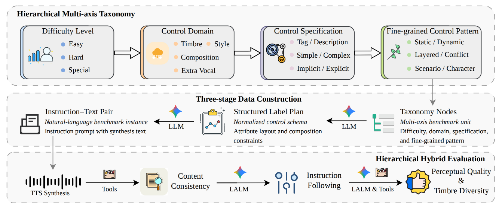

<div align="center">
  

**MINT-Bench: A Comprehensive Multilingual Benchmark for Instruction-Following Text-to-Speech**

[](https://arxiv.org/abs/2604.17958v1) [](https://aslp-lab.github.io/MINT-Bench-Demo/)

</div>

MINT-Bench is a multilingual benchmark for evaluating instruction-following text-to-speech systems on three complementary axes:

- **Intelligibility** via WER
- **Instruction following** via large audio-language model (LALM) judging
- **Timbre diversity** via multi-candidate speaker-similarity analysis

It provides a complete open pipeline for:
- constructing benchmark instances,
- generating audio with reference TTS systems,
- evaluating model outputs,
- visualizing results.

The repository is organized so that users can either:
- run the **official benchmark** used in the paper, or
- build a **DIY benchmark** with the same pipeline and evaluate their own test set.

The leaderboard and detailed evaluation results are available on the [demo page](https://aslp-lab.github.io/MINT-Bench-Demo/).

## Model Architecture

<div align="center">
  
</div>

MINT-Bench consists of three tightly coupled components:
- a **hierarchical multi-axis taxonomy** for benchmark coverage,
- a **three-stage data construction pipeline** for scalable instance creation,
- and a **hierarchical hybrid evaluation protocol** for content consistency, instruction following, and perceptual quality assessment.

## Repository Structure

```text
mint-bench/
├── data_construction/   # Build benchmark instances (nodes -> label plans -> instruction-text pairs)
├── generation/          # Reference TTS generation scripts
├── evaluation/          # WER, instruction-following, timbre-diversity evaluation
├── visualization/       # Streamlit leaderboard / heatmap viewer
├── assets/              # Paper and static assets
└── requirements.txt
```

## Quick Start

### 1. Environment setup

```bash
conda create -n mint-bench python==3.10
conda activate mint-bench
pip install -r requirements.txt
```

### 2. Generate audio first

Evaluation assumes that you already have synthesized audio.

Typical standard output layout:

```text
gen_outputs/<model>_<preset>_outputs_<lang>/
```

Typical timbre candidate layout:

```text
gen_outputs_timbre/<model>_timbre_candidates_<lang>/
```

See [generation/README.md](generation/README.md) for the full generation workflow.

### 3. Run the default evaluation flow

This runs the two default stages:
- WER
- instruction following

```bash
bash evaluation/run_evaluation.sh \
  --model gemini_reference \
  --language en \
  --preset mini \
  --generation_path gen_outputs/gemini_reference_mini_outputs_en
```

By default, evaluation uses the **official instruction-text pair set**:

```text
data_construction/instruction_text_generator/instruction_text_pairs_official/
```

### 4. Evaluate a DIY benchmark

If you built your own pair set with `data_construction/`, pass it explicitly:

```bash
bash evaluation/run_evaluation.sh \
  --model mymodel \
  --language en \
  --preset mini \
  --pairs_path data_construction/instruction_text_generator/instruction_text_pairs/my_diy_pairs \
  --generation_path gen_outputs/mymodel_mini_outputs_en
```

### 5. Inspect results

We strongly recommend using the visualization app:

```bash
bash visualization/run_visualization.sh
```

Or print a compact CLI summary:

```bash
python evaluation/show_results.py
```

## Advanced: Timbre Diversity

Timbre diversity is treated as an advanced evaluation stage because it requires:
- multi-candidate timbre generation,
- LALM filtering of all candidates,
- then diversity scoring over the valid candidates.

Example:

```bash
bash evaluation/run_evaluation.sh \
  --model gemini_reference \
  --language en \
  --preset mini \
  --generation_path gen_outputs/gemini_reference_mini_outputs_en \
  --run_timbre_advanced \
  --timbre_input_json data_construction/instruction_text_generator/instruction_text_pairs_timbre/en_timbre_subset_balanced_100.json \
  --timbre_wav_dir gen_outputs_timbre/gemini_reference_timbre_candidates_en
```

See [evaluation/TIMBRE_DIVERSITY_EVALUATION.md](evaluation/TIMBRE_DIVERSITY_EVALUATION.md) for the full pipeline and checkpoint requirements.

## Official Benchmark vs DIY Benchmark

### Official benchmark

Use the official pair sets shipped in this repo:

```text
data_construction/instruction_text_generator/instruction_text_pairs_official/
```

This is the recommended path if you want results aligned with the paper setup.

### DIY benchmark

Use `data_construction/` to create your own benchmark instances and then pass your own `--pairs_path` into evaluation.

This is useful if you want to:
- modify the benchmark taxonomy,
- change language coverage,
- build a domain-specific subset,
- or benchmark custom control dimensions.

## Documentation Map

- **Data construction:** [data_construction/README.md](data_construction/README.md)
- **Generation:** [generation/README.md](generation/README.md)
- **Evaluation overview:** [evaluation/EVALUATION.md](evaluation/EVALUATION.md)
- **Visualization:** [visualization/README.md](visualization/README.md)

Detailed evaluation stage docs:
- [evaluation/WER_EVALUATION.md](evaluation/WER_EVALUATION.md)
- [evaluation/INSTRUCTION_FOLLOWING_EVALUATION.md](evaluation/INSTRUCTION_FOLLOWING_EVALUATION.md)
- [evaluation/TIMBRE_DIVERSITY_EVALUATION.md](evaluation/TIMBRE_DIVERSITY_EVALUATION.md)

## Citation

If you find our paper and code useful in your research, please consider giving a star ⭐ and citation 📝 :)

```
@article{chen2026mint,
  title={MINT-Bench: A Comprehensive Multilingual Benchmark for Instruction-Following Text-to-Speech},
  author={Chen, Huakang and Hu, Jingbin and Xue, Liumeng and Zhan, Qirui and Li, Wenhao and Ma, Guobin and Xie, Hanke and Guo, Dake and Ma, Linhan and Jiang, Yuepeng and others},
  journal={arXiv preprint arXiv:2604.17958},
  year={2026}
}
```